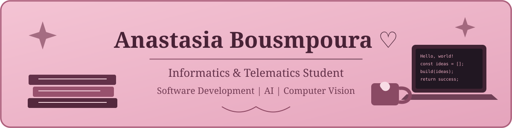

  

---

## ♡ About Me

Hello! I'm Anastasia, an Informatics & Telematics student at Harokopio University of Athens.

- 🎓 Currently studying Informatics & Telematics.
- 💻 Working in IT Systems Support.
- 🧠 Interested in Artificial Intelligence and Computer Vision.
- ✨ Always curious to learn and build something new.

## ♡ Tech Stack

**Languages & Development**

**Tools & Technologies**

## ♡ Featured Projects

*More projects coming soon...*

## ♡ GitHub Statistics

---

*Made with ♡ and a little bit of coffee.*

